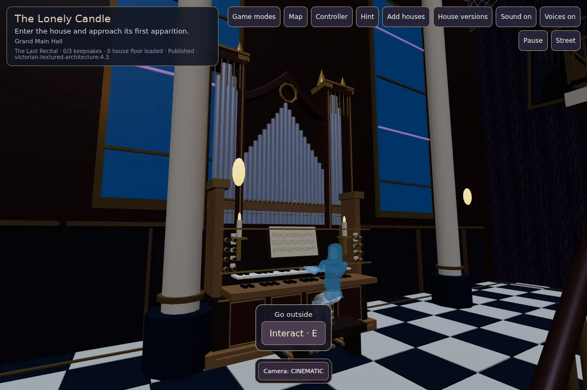
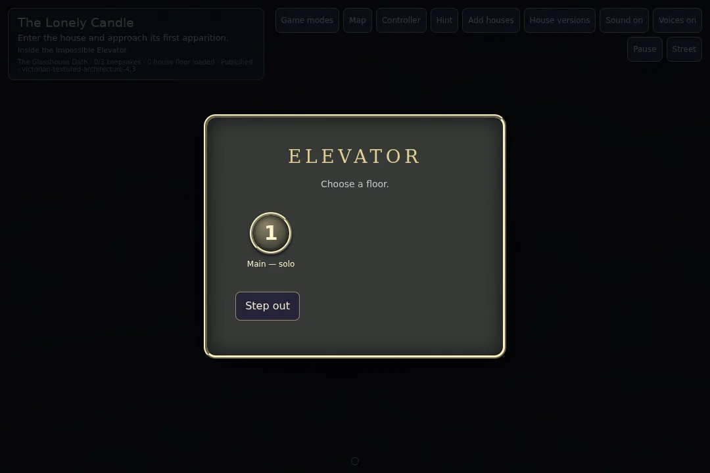

# Black Hallow town, recorded audio, organ and elevator

The town has two crossing streets with four named arms: Nevermore Circle, Blackhollow Way, Coffin Cove and Haunted Forest Lane. A 33-house catalog distributes 9/8/8/8, ending each arm in a walkable roundabout. Authored entrance transforms, Halloween hosts and candy use each arm's coordinate system. Only actual catalog houses create lots; exterior residency remains bounded.

The three supplied recordings are converted to Ogg Vorbis. Musical saw loops independently of greeting, owl, door and synthesized effects. Halloween dialogue does not duck or restart the saw. Owls hoot on approach and the entrance owl flies away; reduced motion removes its flight.

The Hall awaits the articulated organist asset before becoming playable. Its departure lasts for the current loaded visit; loading the house again starts the performance, even with an older saved departure flag. Rat clues and organ departure no longer create explanatory popups; the initial story modal is removed.

Elevator doors open by proximity, chime, and board automatically from the certified boarding area. Cabin doors close for one second before the panel appears. The current destination is absent. Forge writes stable labels through `assignElevatorButtons`; Game applies the same rule to older CASA contracts. G is the Hall, B is basement/crypt/cellar, primary destinations are numbered before disconnected areas, and 13 is skipped until its quest unlock. Stop IDs and geometry remain unchanged.

Validation: complete quest flows with shipped and freshly compiled CASA archives; 33-house layout and rotated entrance matrices; independent audio bus and owl motion tests; browser checks decode all supplied recordings and verify advancing saw playback under effects, visible organist, reload behavior, automatic landing doors and numbered panel. CI also exercises Forge, stairs, pipeline, encounters, room dressing and Halloween visits.

