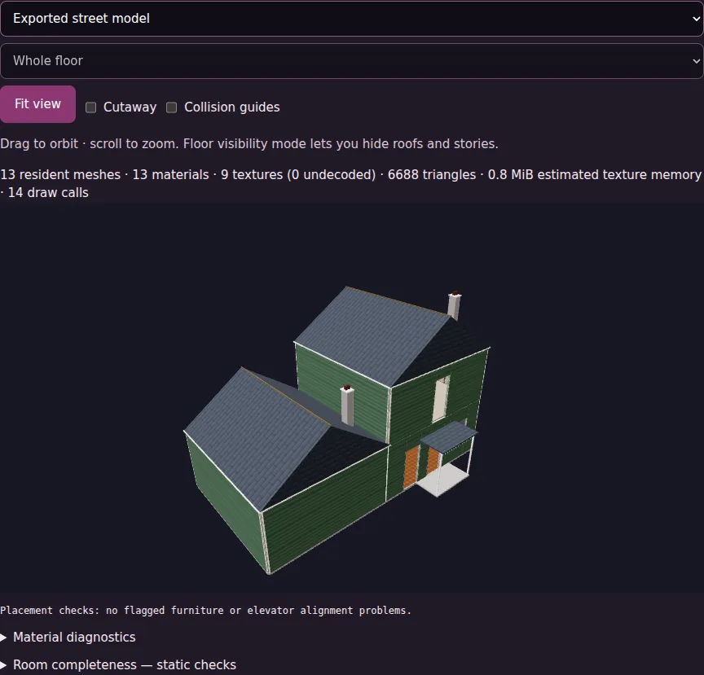
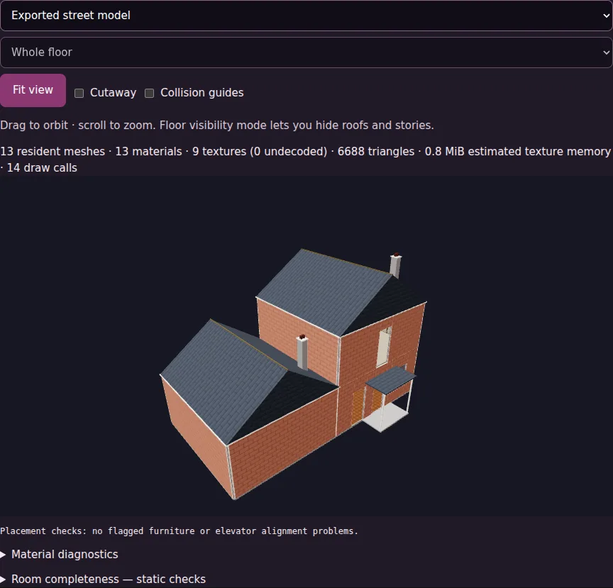
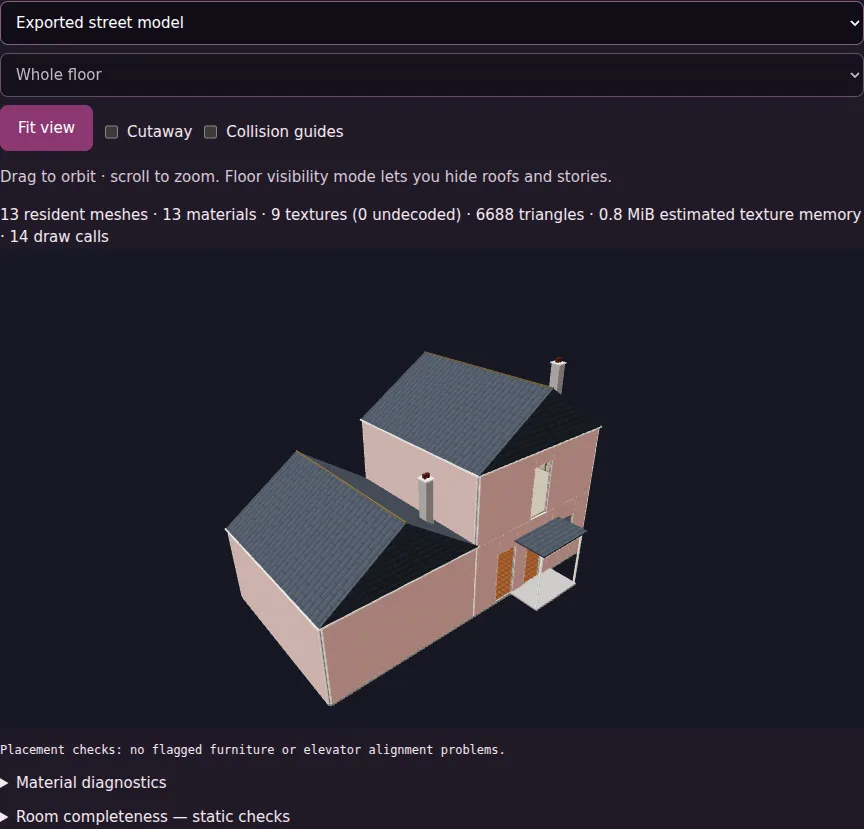

# Student house preparation and exterior finishes

Forge now assigns stable identities to generic rooms, preserves named/authored room identities, and uses the same theme for architectural finishes, furniture, story details and reactions. Original `.haunt` content is preserved; the themed working copy and room-theme inventory are packaged in CASA. Existing compiled houses need recompiling to receive this content.

The compiler offers 14 wall finishes (six siding, four brick, four stucco), five trim colors and four roof tints. Automatic selection is deterministic; valid `exterior.style`, `exterior.trim`, `exterior.roof`, and room `roomTheme` values are honored. Brick and stucco use separate embedded procedural textures. Street preview and floor architecture share the selected exterior palette.

`qa/student_report.json` explains entrance, doorway, headroom and elevator repairs, reports stair fallbacks, lists room themes and room-content findings, and separates unresolved blockers from runtime checks. House Office disables publishing packages with reported blockers while preserving local download/playtesting. Old packages are labeled for recompiling rather than silently declared current. Static preparation never claims a rendered or physical certification.

## Validation

- Core tests cover all 14 material exports, deterministic themes, original source preservation and a two-story house with no entrances, no stairs and a disconnected room.
- Browser checks compile siding/brick/stucco variants using the actual Forge controls, decode their textures in WebGL previews, and verify publication blocking with local playtesting still available.
- Existing complete-quest tests run with published packages and fresh Forge compilations. House Office -> Forge -> preview -> local Game -> simulated publication -> clean Game passes.
- Room browser checks cover eight themed room types and a tiny room. Screenshots below show the exported models; they are representative previews, not certification of all student designs.

## Limits

Furniture targets can still be unmet when there is no safe placement; these remain explicit room findings. Unsupported authored decor/rotations require review. Unsafe or unsupported stairs use the existing elevator bypass. Arbitrary overlaps and malformed identifiers are not guessed away. Finishes currently apply house-wide; the planner does not generate mixed-material facades. New content is applied through recompilation, not by rebuilding houses in the Game.
